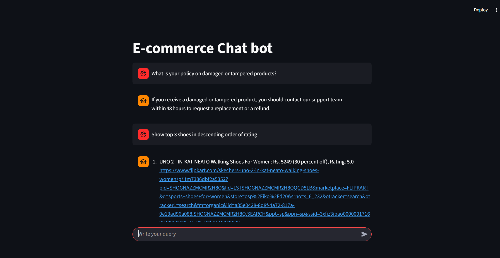
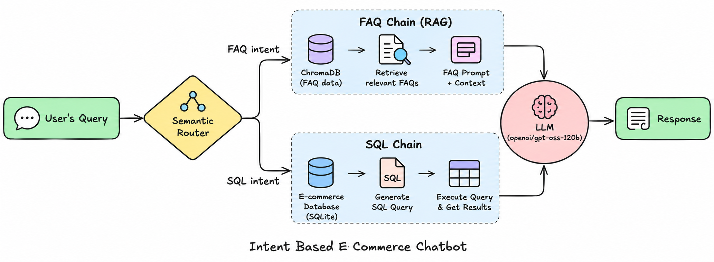

# 💬 E-Commerce Chatbot — GenAI RAG Project

This project is a proof-of-concept e-commerce chatbot designed to understand user intent and route queries to the appropriate workflow. It combines semantic routing, retrieval-augmented generation (RAG), real-time database access, and Groq-hosted LLMs to provide relevant and up-to-date responses.

## Folder Structure

1. `app/` — Contains the core chatbot application.
2. `web-scraping/` — Contains scripts used to scrape and prepare e-commerce product data.

## Supported Intents

The chatbot currently supports two types of user queries:

- **FAQ** — Handles questions related to store policies and general customer support, such as returns, refunds, payments, order tracking, cancellations, and damaged products.

  Example:  
  `What is your policy on damaged products?`

- **SQL** — Converts natural-language product queries into SQL using an LLM, executes them against a SQLite database, and transforms the results into user-friendly responses.

  Example:  
  `Show the top 3 shoes in descending order of rating.`

User intent is identified using `semantic-router` with Hugging Face's `all-MiniLM-L6-v2` embedding model.

## Workflow

For FAQ queries:

`User Query → Semantic Router → ChromaDB Retrieval → Relevant FAQ Context → Groq LLM → Response`

For product-related queries:

`User Query → Semantic Router → SQL Workflow → E-Commerce Database → Response`

## Application Preview



## Architecture



## Setup and Execution

1. Install the required dependencies:

   ```bash
   pip install -r app/requirements.txt
   ```

2. Create a .env file inside the app directory and add the required configuration:

   ```bash
   GROQ_MODEL=<model-name, e.g. llama-3.3-70b-versatile>
   GROQ_API_KEY=<your-groq-api-key>
   EF_MODEL_NAME=sentence-transformers/all-MiniLM-L6-v2
   ```

3. Start the Streamlit application:
   ```bash
   streamlit run app/main.py
   ```

## Tech Stack

- Python
- Streamlit
- Groq
- ChromaDB
- Semantic Router
- Hugging Face Sentence Transformers
- SQLite
- Retrieval-Augmented Generation (RAG)
